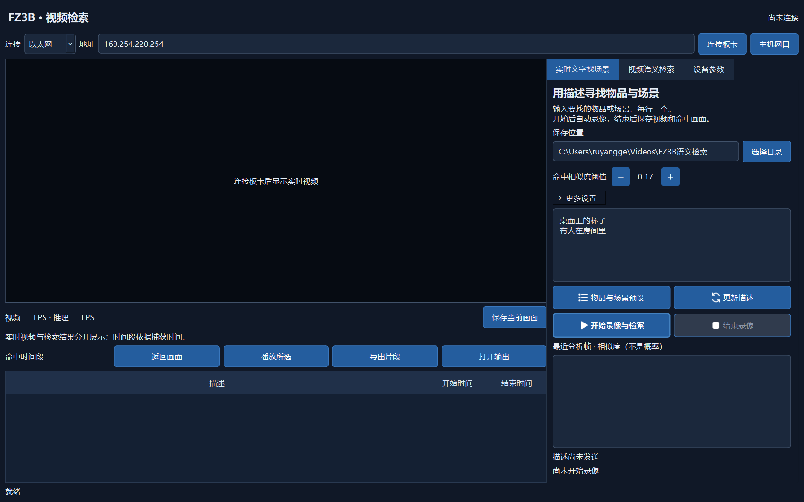
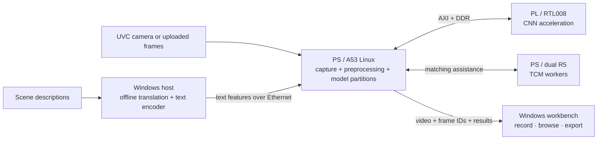

# FZ3B Semantic Video Search

**Describe a scene. Find its moments. Keep the clips.**

[](https://github.com/Geruyang/fz3b-semantic-video-search/tree/2.0)


**English** · [简体中文](README.zh-CN.md) · [Version history](https://github.com/Geruyang/fz3b-semantic-video-search/tags)

A video search research project combining **MobileCLIP-S1**, a **Windows desktop workbench**, and **PS–PL inference on Baidu EdgeBoard FZ3B**. Record a live camera stream or analyze an existing video, search with natural-language descriptions, and export the matching moments.



*The actual client, shown in its disconnected state. The interface is currently in Chinese; the documentation is bilingual.*

## Watch the applications

**Two real application demos in one video · 5 min 45 s · version 2.0**

[](docs/media/fz3b-applications-demo.mp4)

[](docs/media/fz3b-applications-demo.mp4)

**[▶ Open the combined video](docs/media/fz3b-applications-demo.mp4)** · **[Download the full-quality MP4](https://github.com/Geruyang/fz3b-semantic-video-search/releases/download/2.0/fz3b-applications-demo.mp4)** · [Version 2.0 release](https://github.com/Geruyang/fz3b-semantic-video-search/releases/tag/2.0)

| Chapter | Starts at | What you will see |
| --- | --- | --- |
| Application ① — Real-time text-to-scene search | 00:00 | 3-second cover, followed by the live search workbench |
| Application ② — Video semantic search | 03:06.3 | 3-second cover, followed by recorded-video analysis and matching intervals |

Faces are mosaicked and the demo is silent. In the second source recording, **01:02–09:40 is shown at 10× speed**; the accelerated section displays “此处多倍加速节约时间” (“Accelerated here to save time”). The other demonstration sections retain their original speed. Cover art labels the chip **ZYNQ UltraScale+**; **FZ3B** is the board name. The artwork is conceptual, while the footage shows the actual client.

## What you can do

- **Search while recording.** Describe objects or scenes, preserve the received video, and keep original matching frames with timestamps.
- **Search an existing video.** Analyze uploaded frames in order, browse matched intervals, and export clips with the original audio.
- **Use Chinese descriptions offline.** Local translation feeds the pinned MobileCLIP text encoder; semantic search does not require a cloud inference service.
- **Keep useful moments together.** Optional continuity processing reduces fragmented intervals, with one combined export per description.
- **See what the board is doing.** Monitor inference/camera FPS, CPU load, memory, R5 state, temperature and voltages; select 600/800/1000/1200 MHz CPU operation.

## What's new in 2.0

The compute implementation is now **RTL008: handwritten RTL plus AMD standard IP**, replacing the HLS compute implementation in [1.0](https://github.com/Geruyang/fz3b-semantic-video-search/tree/1.0). The PS/model ABI remains A0005-compatible.

The client also includes the current continuity workflow, device telemetry and **recent-ten-image inference FPS**: ten completion intervals, eleven time boundaries. Startup preparation is excluded, the window resets on a new inference session, and uploaded-video progress uses board completion times.

## Three parts, one pipeline



The Linux drivers own the physical camera, Ethernet and UART interfaces. R5 workers assist matching and protocol work; this project does not claim a complete peripheral-stack offload.

| Directory | Responsibility |
| --- | --- |
| [PS/](PS/) | Current Linux/R5 application, inference runtime, drivers, loader and service definitions |
| [PL/](PL/) | RTL008 sources, constraints, final Vivado project inputs, immutable compilation snapshot and selected evidence |
| [HOST/](HOST/) | Current Windows client, maintained tests, pinned source dependencies and build entry |
| [docs/validation/](docs/validation/) | Saved application and real-camera FPS validation |
| [UPLOAD_MANIFEST.json](UPLOAD_MANIFEST.json) | Every published input, its original path, size, SHA256 and inclusion reason |

## Measured, not estimated

The saved comparison uses the same FZ3B boot, **1.2 GHz CPU**, and **200/400 MHz job/PW clocks**. Resource counts are from full-platform post-route reports.

| Metric | 1.0 HLS baseline | 2.0 RTL008 | Change |
| --- | ---: | ---: | ---: |
| LUT | 51,334 | 47,645 | −7.19% |
| Flip-flops | 87,644 | 49,690 | −43.30% |
| BRAM36 equivalents | 162 | 146 | −9.88% |
| DSP48E2 | 214 | 202 | −5.61% |
| Fixed-input pipeline throughput | 4.1244 FPS | 4.3226 FPS | +4.80% |

RTL008 saved setup/hold margins are **+0.006 / +0.010 ns**. See the [post-route receipt](PL/reports/platform/project-final-008/route_receipt.json), [timing report](PL/reports/platform/project-final-008/timing_summary.rpt) and [board comparison receipt](PL/reports/board/candidate008/board_report.json).

The throughput row measures fixed engineering tensors to features, **not camera FPS or a recognition-accuracy score**. Cosine similarity is not a calibrated probability. Live search samples inference frames, so very short events between analyzed frames may be missed.

The latest saved application regression records **92 passed, 1 legacy installation test excluded**. [Regression output](docs/validation/fps-regression.txt) · [Real-camera FPS checks](docs/validation/fps-real-board.json) · [FPS behavior](docs/validation/2026-10-10-recent-inference-fps.md).

## Get started

### Use a prepared board and client bundle

1. Keep the complete `FZ3BVisionConsole` directory: the EXE, `_internal`, `models` and `translation` are all required.
2. Connect to the configured FZ3B over Ethernet. The latest client does not ask for a connection token or password.
3. Enter descriptions, for example **“a cup on a desk”** or **“a person in a room”**, then start recording/searching or select a local video.
4. Review the matching intervals and export clips. The current default cosine threshold is **0.17**; adjust it before starting a task.

### Work with the source

```powershell
git clone https://github.com/Geruyang/fz3b-semantic-video-search.git
cd fz3b-semantic-video-search
python tools/verify_upload.py
python tools/materialize_workspace.py --output workspace
```

The materializer restores the original relative paths in a separate `workspace/`, preserving the three independent source folders. For the client, use **Python 3.12**, install `HOST/requirements.txt` and `pytest` in a local environment, and run the maintained test entry from the restored project root. The final Vivado project is `PL/project-final-008/cnn_rtl.xpr`; its tool version is **Vivado 2026.1**.

This is a **source snapshot**, not an all-in-one binary distribution. Model weights, learned parameters, native runtime libraries, EXE/BIT/DCP and full simulation vectors are managed separately. To run or rebuild, supply the matching resource bundle and honor the hashes in the semantic/model contracts. Board initialization/preset availability and cold-reboot validation remain separate from the saved RTL qualification.

## Versioning

[`main`](https://github.com/Geruyang/fz3b-semantic-video-search/tree/main) tracks the latest published version. [`1.0`](https://github.com/Geruyang/fz3b-semantic-video-search/tree/1.0) preserves the previous release; [`2.0`](https://github.com/Geruyang/fz3b-semantic-video-search/tree/2.0) fixes this snapshot. Every future version uses the **version number supplied by the user**, updates `main`, and receives an immutable annotated tag. [Publication policy](RELEASE_POLICY.md).

## Model provenance and licensing

MobileCLIP source and model identities are pinned in [the semantic contract](HOST/vision_app/semantic-contract.json). The upstream code license and the separate, research-only model license are retained under [HOST/model-source/official-mobileclip/](HOST/model-source/official-mobileclip/). The code's upstream MIT license does not extend the model weights' permitted uses.
