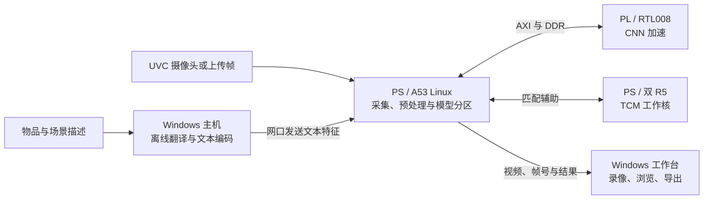

# FZ3B 语义视频检索

**描述一个场景，找到它出现的时刻，留下需要的片段。**

[](https://github.com/Geruyang/fz3b-semantic-video-search/tree/2.0)


[English](README.md) · **简体中文** · [历史版本](https://github.com/Geruyang/fz3b-semantic-video-search/tags)

将 **MobileCLIP-S1**、**Windows 视频工作台**与**百度 EdgeBoard FZ3B 的 PS–PL 推理**结合的研究项目。可以边录像边检索，也可以分析已有视频：用自然语言寻找物品与场景，浏览命中时间段，再导出需要的片段。


*实际客户端截图，处于未连接状态。软件界面当前为中文，仓库文档提供中英文版本。*

## 能做什么

- **边录像，边找场景。** 输入物品或场景描述，保存收到的视频，并按原始帧号与时间保存命中图像。
- **检索已有视频。** 按顺序分析上传帧，浏览命中区间，导出片段并保留原音轨。
- **中文描述，离线处理。** 主机本地翻译后调用固定版本的 MobileCLIP 文本编码器；语义检索不依赖云端推理服务。
- **让有用片段更连贯。** 可选连续片段优化减少短暂掉分导致的碎片，每个描述导出一个汇总视频。
- **看见板端运行状态。** 查看推理/相机 FPS、CPU 占用、内存、R5 状态、温度和电压，并选择 600/800/1000/1200 MHz 四档 CPU 频率。

## 2.0 更新

计算实现已升级为 **RTL008：手写 RTL 与 AMD 标准 IP**，替代 [1.0](https://github.com/Geruyang/fz3b-semantic-video-search/tree/1.0) 的 HLS 计算实现，保持 A0005 兼容的 PS/模型 ABI。

客户端包含当前连续片段工作流、设备遥测与**最近十张图像的推理 FPS**：保留十一个完成时间边界，计算十个完成间隔。启动准备时间不计入，每次重新推理清空窗口，上传视频进度采用板端完成时间。

## 三端协作，一条数据链



摄像头、网口和 UART 的物理驱动仍由 Linux 管理。R5 辅助匹配和协议工作，不表示已经接管完整外设协议栈。

| 目录 | 负责内容 |
| --- | --- |
| [PS/](PS/) | 当前 Linux/R5 应用、推理运行时、驱动、加载器与服务定义 |
| [PL/](PL/) | RTL008 源码、约束、最终 Vivado 工程输入、冻结编译快照和精选证据 |
| [HOST/](HOST/) | 当前 Windows 客户端、维护中的测试、固定源码依赖与构建入口 |
| [docs/validation/](docs/validation/) | 已保存的应用与真实相机 FPS 验证 |
| [UPLOAD_MANIFEST.json](UPLOAD_MANIFEST.json) | 每个上传文件的原路径、大小、SHA256 与保留原因 |

## 有实测依据的结果

已保存的对比采用同一 FZ3B boot、**1.2 GHz CPU**和 **200/400 MHz job/PW 时钟**。资源数据均取完整平台 post-route 报告。

| 指标 | 1.0 HLS 基线 | 2.0 RTL008 | 变化 |
| --- | ---: | ---: | ---: |
| LUT | 51,334 | 47,645 | −7.19% |
| 触发器 | 87,644 | 49,690 | −43.30% |
| BRAM36 等效 | 162 | 146 | −9.88% |
| DSP48E2 | 214 | 202 | −5.61% |
| 固定输入流水吞吐 | 4.1244 FPS | 4.3226 FPS | +4.80% |

RTL008 已保存的 setup/hold 余量为 **+0.006 / +0.010 ns**。证据见 [post-route 回执](PL/reports/platform/project-final-008/route_receipt.json)、[时序报告](PL/reports/platform/project-final-008/timing_summary.rpt)和[板端对比回执](PL/reports/board/candidate008/board_report.json)。

吞吐一项测的是固定工程 tensor 到特征输出，**不等于摄像头 FPS，也不代表识别准确率**。余弦相似度不是经过校准的概率。实时检索只分析推理采样帧，两个分析帧之间的短暂事件可能遗漏。

最近一次已保存应用回归为 **92 项通过，排除 1 项旧安装工具测试**。[回归输出](docs/validation/fps-regression.txt) · [真实相机 FPS 核验](docs/validation/fps-real-board.json) · [FPS 显示口径](docs/validation/2026-10-10-recent-inference-fps.md)。

## 快速开始

### 使用已配置板卡和客户端包

1. 完整保留 `FZ3BVisionConsole` 目录：EXE、`_internal`、`models`、`translation` 缺一不可。
2. 通过网口连接已配置好的 FZ3B，最新客户端无需填写连接令牌或密码。
3. 输入“**桌面上的杯子**”“**有人在房间里**”等描述，开始录像与检索，或选择本机视频分析。
4. 浏览命中时间段并导出片段。当前余弦阈值默认 **0.17**，可在任务开始前调整。

### 使用源码

```powershell
git clone https://github.com/Geruyang/fz3b-semantic-video-search.git
cd fz3b-semantic-video-search
python tools/verify_upload.py
python tools/materialize_workspace.py --output workspace
```

还原工具会在独立的 `workspace/` 中恢复原工程相对路径，仓库中的三端源码目录保持独立。客户端采用 **Python 3.12**，在本地环境安装 `HOST/requirements.txt` 与 `pytest`，再从还原后的工程根目录执行维护中的回归入口。最终 Vivado 工程为 `PL/project-final-008/cnn_rtl.xpr`，工具版本为 **Vivado 2026.1**。

仓库是**源码快照**，不是全部运行资源的二进制整包。模型权重、学习参数、原生运行库、EXE/BIT/DCP 和完整仿真向量单独管理。运行或重建时需提供匹配的资源包，并遵守语义/模型合同中的哈希。板级初始化 preset 的可重建性与冷启动重启验证，仍与现有 RTL 签核分开核定。

## 版本管理

[`main`](https://github.com/Geruyang/fz3b-semantic-video-search/tree/main) 始终指向最新发布版本；[`1.0`](https://github.com/Geruyang/fz3b-semantic-video-search/tree/1.0) 保存上一版，[`2.0`](https://github.com/Geruyang/fz3b-semantic-video-search/tree/2.0) 固定本次快照。以后使用**用户指定的版本号**更新 `main`，并创建不可变的 annotated tag 保存对应版本。[发布规则](RELEASE_POLICY.md)。

## 模型来源与许可

MobileCLIP 源码和模型身份固定在[语义合同](HOST/vision_app/semantic-contract.json)中，上游源码许可与独立的研究用途模型许可保留在 [HOST/model-source/official-mobileclip/](HOST/model-source/official-mobileclip/)。上游代码的 MIT 许可不扩展模型权重的允许用途。
