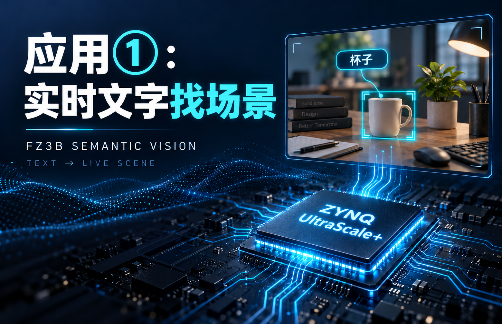
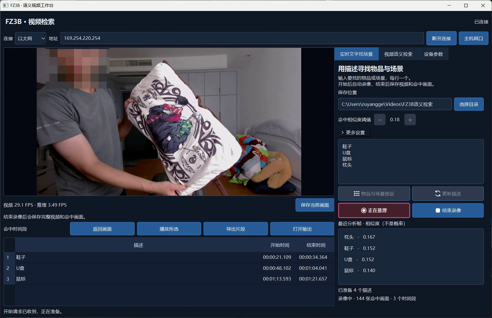
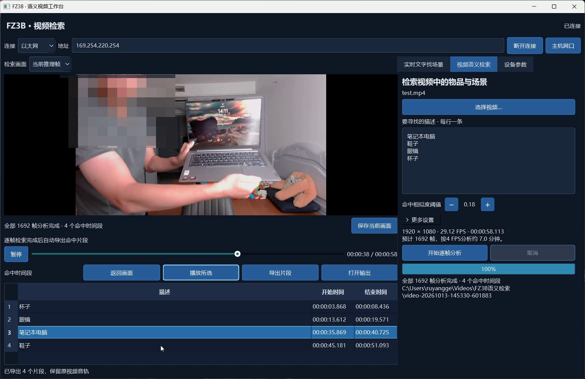
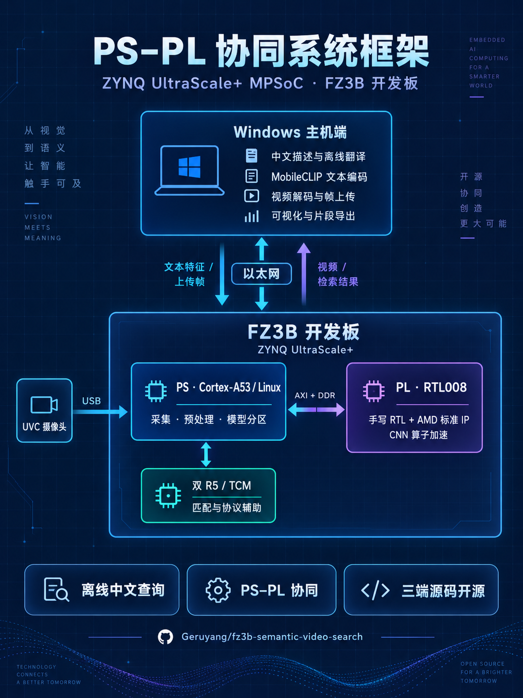
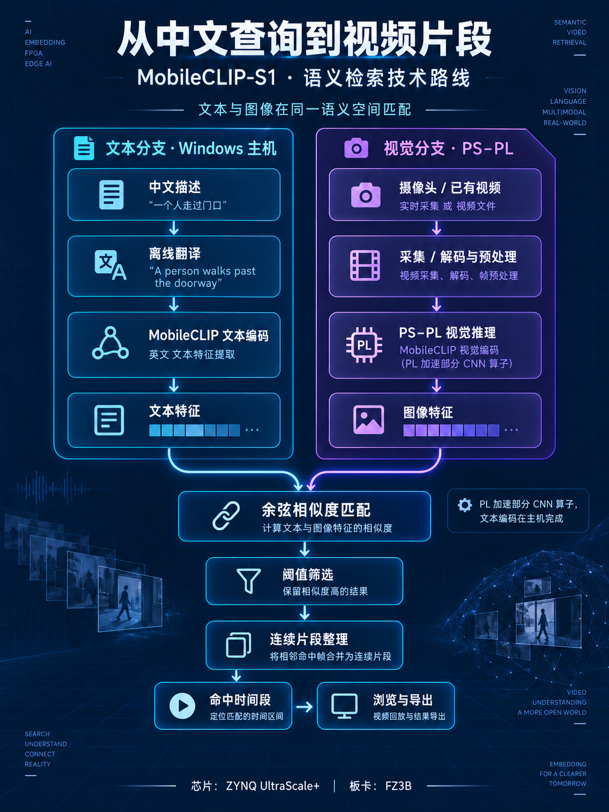

# FZ3B 语义视频检索

**基于 ZYNQ UltraScale+ 的 PS–PL 协同视频语义检索系统。**

[](https://github.com/Geruyang/fz3b-semantic-video-search/releases/tag/2.1)


[English](README.md) · **简体中文** · [2.1 发布](https://github.com/Geruyang/fz3b-semantic-video-search/releases/tag/2.1) · [历史版本](https://github.com/Geruyang/fz3b-semantic-video-search/tags)

将 **MobileCLIP-S1**、**Windows 视频工作台**与**百度 EdgeBoard FZ3B 的 PS–PL 视觉推理**结合的工程研究项目。输入物品或场景描述，在实时画面或已有视频中定位相关时刻，再浏览和导出需要的片段。**ZYNQ UltraScale+ MPSoC 是芯片系列，FZ3B 是开发板代号。**

## 完整解说演示

[](https://github.com/Geruyang/fz3b-semantic-video-search/releases/download/2.1/fz3b-applications-demo.mp4)

**[▶ 在仓库中打开视频](docs/media/fz3b-applications-demo.mp4)** · **[下载解说配乐版 MP4](https://github.com/Geruyang/fz3b-semantic-video-search/releases/download/2.1/fz3b-applications-demo.mp4)** · **[下载四张项目推广图](https://github.com/Geruyang/fz3b-semantic-video-search/releases/download/2.1/project-images-2.1.zip)**

成片约 **5 分 45 秒**，包含两种应用、各 3 秒章节封面、中文技术解说与118 BPM欢快科技感原创电子配乐，包含明亮合成器琶音、轻快节奏与温暖低音。旁白出现时背景音乐自动降低；人脸马赛克继续保留，原始录像的声音仍已移除。

| 章节 | 开始时间 | 演示内容 |
| --- | --- | --- |
| ① 实时文字找场景 | 00:00 | 摄像头检索、命中区间、回放与导出 |
| ② 视频语义检索 | 03:06.3 | 已有视频分析、命中时间段与片段浏览 |

第二段原始录像的 **01:02–09:40** 以 **10 倍速**展示，并持续显示“此处多倍加速节约时间”；其余演示区间保持原速。
旁白由 AI 配音，118 BPM欢快配乐由振荡器和噪声合成原创制作。[解说词](docs/media/narration/script.md) · [声音与视频验证回执](docs/media/narration/audio-receipt.json)。

## 两种应用工作流

### ① 实时文字找场景

输入中文描述，在录像过程中检索物品或场景，保存命中画面和时间段。工作台显示推理/相机 FPS 与相似度，并支持录像后的回放和片段导出。



### ② 视频语义检索

选择本地视频，输入笔记本电脑、鞋子、眼镜或杯子等描述。系统按顺序分析视频帧，整理命中时间段，再回放或导出选中的片段。



以上为既有实机录像中直接提取的完整界面，画面状态与数值来自对应录像，均保留人脸马赛克。[截图来源与生成提示](docs/media/xiaohongshu/prompts.json)。

## 系统架构与技术路线

| 系统框架 | 语义检索技术路线 |
| --- | --- |
| [](docs/media/xiaohongshu/01-系统框架.png) | [](docs/media/xiaohongshu/02-技术路线.png) |

**Windows 主机**完成中文离线翻译、文本编码、上传视频解码和可视化。**PS / Cortex-A53 Linux**负责采集、预处理与模型分区；**PL / RTL008**通过 AXI 与 DDR 加速部分 CNN 算子；**双 R5 / TCM 工作核**辅助匹配与协议处理。摄像头、网口和 UART 的物理驱动仍由 Linux 管理。

文本与图像特征通过余弦相似度匹配，经阈值筛选和连续片段整理后，形成可浏览、可导出的命中时间段。当前客户端可以按描述汇总相关片段，中文查询与语义推理无需云端推理服务。

| 源码目录 | 负责内容 |
| --- | --- |
| [PS/](PS/) | Linux/R5 应用、推理运行时、驱动、加载器与服务 |
| [PL/](PL/) | 手写 RTL008、约束、最终 Vivado 工程输入与已保存签核 |
| [HOST/](HOST/) | Windows 客户端、维护中的测试、固定源码依赖与构建入口 |
| [docs/media/](docs/media/) | 解说演示、封面、项目图片与媒体身份 |
| [docs/validation/](docs/validation/) | 已保存应用与真实相机 FPS 验证 |
| [UPLOAD_MANIFEST.json](UPLOAD_MANIFEST.json) | 发布路径、输入身份、大小与 SHA256 |

## 2.1 更新

- 完整双应用视频加入中文解说、欢快科技感原创电子配乐和旁白期间的音乐自动压低。
- 纳入四张项目图片：系统框架、技术路线，以及两张真实客户端截图。
- 重新组织中英文 README，以应用演示和工程实现为主线。

计算与应用实现继续采用 **RTL008 / A0005 兼容 ABI**，沿用 2.0。此次更新演示资料和文档，PS、PL、HOST 源码身份保持一致；客户端继续提供设备遥测与最近十张图像的推理 FPS。

## 实测与验证依据

已保存的对比采用同一 FZ3B boot、**1.2 GHz CPU**和 **200/400 MHz job/PW 时钟**。资源数据均取完整平台 post-route 报告。

| 指标 | 1.0 HLS 基线 | RTL008（2.0 / 2.1） | 变化 |
| --- | ---: | ---: | ---: |
| LUT | 51,334 | 47,645 | −7.19% |
| 触发器 | 87,644 | 49,690 | −43.30% |
| BRAM36 等效 | 162 | 146 | −9.88% |
| DSP48E2 | 214 | 202 | −5.61% |
| 固定输入流水吞吐 | 4.1244 FPS | 4.3226 FPS | +4.80% |

RTL008 已保存的 setup/hold 余量为 **+0.006 / +0.010 ns**。证据见 [post-route 回执](PL/reports/platform/project-final-008/route_receipt.json)、[时序报告](PL/reports/platform/project-final-008/timing_summary.rpt)和[板端对比回执](PL/reports/board/candidate008/board_report.json)。

吞吐一项测的是固定工程 tensor 到特征输出，**不等于摄像头 FPS，也不代表识别准确率**。余弦相似度不是经过校准的概率。实时检索只分析推理采样帧，两个分析帧之间的短暂事件可能遗漏。

最近一次已保存应用回归为 **92 项通过，排除 1 项旧安装工具测试**。[回归输出](docs/validation/fps-regression.txt) · [真实相机 FPS 核验](docs/validation/fps-real-board.json) · [FPS 显示口径](docs/validation/2026-10-10-recent-inference-fps.md)。

## 快速开始

### 使用已配置板卡和客户端包

1. 完整保留 `FZ3BVisionConsole` 目录：EXE、`_internal`、`models`、`translation` 缺一不可。
2. 通过网口连接已配置好的 FZ3B，最新客户端无需填写连接令牌或密码。
3. 输入“**桌面上的杯子**”“**有人在房间里**”等描述，开始录像与检索，或选择本机视频分析。
4. 浏览命中时间段并导出片段。当前余弦阈值默认 **0.17**，可在任务开始前调整。

### 使用源码

```powershell
git clone https://github.com/Geruyang/fz3b-semantic-video-search.git
cd fz3b-semantic-video-search
python tools/verify_upload.py
python tools/materialize_workspace.py --output workspace
```

还原工具会在独立的 `workspace/` 中恢复原工程相对路径，仓库中的三端源码目录保持独立。客户端采用 **Python 3.12**，在本地环境安装 `HOST/requirements.txt` 与 `pytest`，再从还原后的工程根目录执行维护中的回归入口。最终 Vivado 工程为 `PL/project-final-008/cnn_rtl.xpr`，工具版本为 **Vivado 2026.1**。

仓库是**源码快照**，不是全部运行资源的二进制整包。模型权重、学习参数、原生运行库、EXE/BIT/DCP 和完整仿真向量单独管理。运行或重建时需提供匹配的资源包，并遵守语义/模型合同中的哈希。板级初始化 preset 的可重建性与冷启动重启验证，仍与现有 RTL 签核分开核定。

## 版本管理

[`main`](https://github.com/Geruyang/fz3b-semantic-video-search/tree/main) 保存最新发布文件，[`2.1`](https://github.com/Geruyang/fz3b-semantic-video-search/tree/2.1) 固定本次发布。[`2.0`](https://github.com/Geruyang/fz3b-semantic-video-search/tree/2.0) 与 [`1.0`](https://github.com/Geruyang/fz3b-semantic-video-search/tree/1.0) 继续保留。版本号由用户指定，每次发布创建不可变的 annotated tag。[发布规则](RELEASE_POLICY.md)。

## 模型来源与许可

MobileCLIP 源码和模型身份固定在[语义合同](HOST/vision_app/semantic-contract.json)中，上游源码许可与独立的研究用途模型许可保留在 [HOST/model-source/official-mobileclip/](HOST/model-source/official-mobileclip/)。上游代码的 MIT 许可不扩展模型权重的允许用途。
